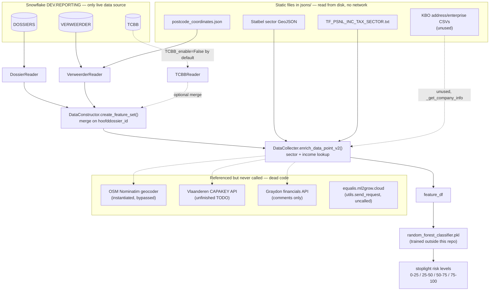

# CLAUDE.md

This file provides guidance to Claude Code (claude.ai/code) when working with code in this repository.

## What this is

A data pipeline (not yet a proper package — no tests, no linter config, no `pyproject.toml`) that pulls debt-collection case data ("dossiers") from Snowflake, enriches it with derived features (address geocoding, geographic sector lookup, income statistics, seizure/TCBB features), and feeds a pre-trained `RandomForestClassifier` (`random_forest_classifier.pkl`, loaded via `joblib`) to predict solvency ("solvabiliteit") of debtors ("verweerders"). The domain and most column/variable names are in Dutch (Belgian legal-collections domain: dossiers, verweerders = defendants/debtors, aanleggers = plaintiffs, beslag = seizure).

There is no git repository initialized here yet, no README, and no automated test suite. Development happens primarily through `inference.ipynb`.

## Setup & running

```bash
pip install -r requirements.txt
```

Snowflake credentials are read from environment variables via `python-dotenv` (expects a `.env` file, not present in repo — see `.env.example` for the template): `SF_USER`, `SF_ACCOUNT`, `SF_DATABASE`, `SF_SCHEMA`, `SF_WAREHOUSE`, `SF_ROLE` (see `config/snowflake_config.py`).

Auth is either key-pair (preferred — `SF_PRIVATE_KEY_PATH`, optionally `SF_PRIVATE_KEY_PASSPHRASE`) or password (`SF_PASSWORD`, legacy fallback, may be disabled on accounts that have moved off single-factor password auth). If `SF_PRIVATE_KEY_PATH` is set, `SnowflakeConfig` reads and DER-encodes the PEM key and passes it via `connect_args` on the SQLAlchemy engine (`SnowflakeClient`) rather than the connection URL. Never commit the private key file or `.env` — both are gitignored.

There is no CLI entry point — the pipeline is driven from `inference.ipynb`, which:
1. Instantiates `DataConstructor(TCBB_enable=False, address_enabled=True)` — builds Snowflake client, query executor, snapshot manager, and the three dataset readers.
2. Calls `.create_feature_set()` to produce the full feature DataFrame.
3. Loads `random_forest_classifier.pkl` and calls `.predict_proba()`, then buckets probabilities into 4 "stoplight" risk levels (0.0–0.25 / 0.25–0.5 / 0.5–0.75 / 0.75–1.0).

**Known gap:** `dossiers_query.sql` currently filters to *concluded* dossiers only (`dossier_status_code IN ('STPOPD','REGLE','TERU','GESM','STPZ','GZ')`) because that's what the training pipeline needed. For actual inference you need dossiers that are still open — this query must be edited before inference will return anything useful (see comment in `inference.ipynb`).

`extractor/verweerders_reader.py` does `from utils import get_geboortedatum, get_leeftijd`, resolved by the top-level `utils.py` (also home to `send_request`/`send_request_retry`, plotting/threshold helpers, and other shared utilities).

## Architecture

### Pipeline flow (`core/data_constructor.py`)

`DataConstructor` is the orchestrator. It wires together:
- `SnowflakeConfig` → `SnowflakeClient` (SQLAlchemy engine) → `QueryExecutor` (runs `pd.read_sql`)
- `SnapshotManager` — disk cache for query results (see caching model below)
- `DatasetConfig` — tracks a content-hash "version" per dataset (`dossiers`, `verweerders`, `TCBB`)
- Three `BaseReader` subclasses, one per dataset: `DossierReader`, `VerweerderReader`, `TCBBReader`
- `DataCollecter` (in `core/enriching.py`) — geo/income enrichment, independent of the reader hierarchy

`create_feature_set()` runs the readers, merges `dossiers` + `verweerders` on `hoofddossier_id`, optionally enriches with geo/income data (`address_enabled`), and optionally merges in TCBB seizure features (`TCBB_enable`, off by default — slow/unfinished path).

### Reader hierarchy (`core/base_reader.py` + `extractor/*.py`)

`BaseReader` (abstract) is the shared engine for all three dataset readers:
- Assembles the final SQL by loading `main_query_file` and substituting `{placeholder}` tokens with the contents of files listed in `ReaderConfig.subquery_files` (see `sql/partials/`).
- `get_data` (a `cached_property`) is the **snapshot/caching entry point**: it hashes the resolved SQL (+ transform names, optionally) into a `logic_hash`, compares against the configured version in `DatasetConfig.dataset_versions`, and either loads a cached parquet snapshot from `data/` or re-runs the query and saves a new one. This means **editing a SQL query changes its hash**, which invalidates the cache automatically — but the hardcoded version strings in `DataConstructor.__init__` (`global_dataset_config`) need to be understood as "last known good hash," not something to hand-edit blindly.
- Subclasses implement `apply_initial_filter()` (required abstract method, runs once right after a fresh query result is cached) and register a pipeline of `transforms` via `add_transform()` (run every time `get_features()` is called, in registration order).
- `DossierReader`: computes weighted/cumulative `bedrag` (payment amounts) per dossier via an `action_map` of booking codes → weight, and derives the `y` / `dossier_status_label_reg` / `dossier_status_label_cat` model labels.
- `VerweerderReader`: derives address-stability features (`n_people_at_address`, address-change counts per dossier), estimated age, and lat/long via a static postcode lookup (`jsons/postcode_coordinates.json`) — a cheaper stand-in for live geocoding.
- `TCBBReader`: seizure ("beslag") record features — both a row-by-row (`get_features_from_subset`, slow, effectively superseded) and a vectorized (`get_vectorized_features`, groupby/merge-based) implementation exist; only the vectorized one is used from `DataConstructor`.

### Geo/income enrichment (`core/enriching.py`, `core/sector_locator.py`)

`DataCollecter` converts addresses/coordinates → Belgian statistical-sector info → income statistics:
- `SectorLocator` builds a `shapely` `STRtree` spatial index from a Statbel GeoJSON (`jsons/sh_statbel_statistical_sectors_*.geojson`) to map a Lambert72 point to its statistical sector polygon.
- `enrich_data_point_v2` is the vectorized path actually used (WGS84→Lambert72 transform via `pyproj`, geometry build, per-row sector+income lookup). `enrich_data_address` (live Nominatim geocoding) and `enrich_data_point` (scalar version) are legacy/slow alternatives kept for reference — geocoding "takes way too long" per the comments and is bypassed by the postcode-based approximation instead.
- Several methods (`get_house_info`, `_get_perceel_insight`, `_get_company_info`, `_get_entity_density`) are unfinished/unused TODOs relying on data files or APIs not currently wired up (Vlaanderen CAPAKEY API is noted as no longer working; KBO enterprise/address CSVs are commented out).

### Config objects (`config/*.py`)

Plain `dataclasses`, no validation framework: `SnowflakeConfig` (env-driven), `ReaderConfig` (SQL file paths + subquery placeholder map), `DatasetConfig` (dataset name → cache version/hash), `CollectorConfig` (paths to static enrichment data files under `jsons/`).

### Data & snapshot layout

- `data/` — snapshot cache: `{dataset}_{hash}.parquet` + a matching `.metadata.txt` (the resolved SQL + transform names, for human inspection/debugging cache misses).
- `jsons/` — static reference data: Statbel sector GeoJSONs, tax-per-sector data (`TF_PSNL_INC_TAX_SECTOR.txt`), postcode→coordinate lookup, KBO enterprise CSVs, and `path_config.json` (paths for an older CSV-based ingestion path, largely superseded by the Snowflake queries in `sql/`).
- `sql/` — main queries (`dossiers_query.sql`, `verweerders_query.sql`, `TCBB_query.sql`, `aanlegger_query.sql`) plus `sql/partials/` for the `{placeholder}` subqueries substituted in by `BaseReader`.

### External data sources

**Snowflake is the only live external data source actually pulled from at runtime.** Everything else is either a static file bundled in the repo, or code referencing an external API/service that isn't actually called anywhere:

- **Live & active:** Snowflake tables `DOSSIERS`, `VERWEERDER`, `TCBB` (queried when `TCBB_enable=True`). `AANLEGGER` has a query file (`sql/aanlegger_query.sql`) but no reader wired into `DataConstructor` — unused.
- **Static bundled files** (`jsons/`, read from disk, no network calls): Statbel statistical-sector boundaries (GeoJSON), Belgian income-tax-per-sector data, a postcode→coordinate lookup, and KBO (Crossroads Bank for Enterprises) open-data CSVs (only used by the unfinished `_get_company_info`).
- **Referenced but dead code — no live calls happen in the current pipeline:**
  - OSM **Nominatim** geocoder (`geopy`) — instantiated in `DataCollecter.__init__`, but the live-geocoding path (`enrich_data_address`) is bypassed in favor of the static postcode lookup.
  - Vlaanderen **CAPAKEY** REST API — only in the unfinished `_get_perceel_insight`/`get_house_info` TODOs; noted as no longer working anyway.
  - **Graydon** company-financials API — only exists as commented-out reference URLs in `core/enriching.py`, never implemented.
  - `https://equalis.ml2grow.cloud` — `utils.send_request`/`send_request_retry` POST here, but neither function is called anywhere in the codebase.
- **No other databases** (no Postgres/MySQL/SQLite/MongoDB/etc.) anywhere in the codebase.
- `requirements.txt` also lists `google-cloud-storage`, `mlflow`, `ollama`, and `forestci`, none of which are imported anywhere — likely leftovers from (or dependencies of) the training pipeline that produced `random_forest_classifier.pkl`, which lives outside this repo.



## Working in this codebase

- When changing a reader's SQL or transforms, remember the cache keys off a hash of the *resolved* SQL text (comments included) — a no-op comment edit will still trigger a full Snowflake re-query and a new parquet snapshot.
- `TCBB_enable` and the live-geocoding paths in `enriching.py` are intentionally disabled by default for performance reasons — don't re-enable them without checking the surrounding NOTE/TODO comments first.
- Several `TODO`/`NOTE` comments throughout (`data_constructor.py`, `base_reader.py`, `dossier_reader.py`, `verweerders_reader.py`) flag known modeling/data-quality caveats (e.g., address dedup on merge, logger vs. `print`, pydantic config loading) — check these before "fixing" something that may be a deliberate placeholder.
